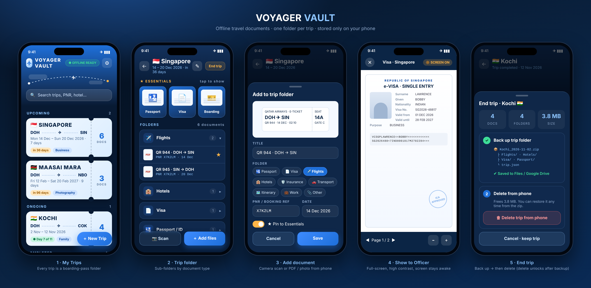

# ✈️ Voyager Vault

**Offline travel documents for your phone, with one folder per trip.**

Keep your passport copy, visa, flight tickets, hotel bookings and insurance in a folder for each trip. Everything is stored **only on your phone**. It opens with no internet, so you can show documents to immigration, airline or hotel staff in airplane mode.



## Features
- **One folder per trip**, with sub-folders for Passport/ID, Visa, Flights, Hotels, Insurance, Transport, Itinerary, Work/Permits and Other. Files are sorted automatically by name (for example, `eVisa.pdf` goes into Visa).
- **📷 Scan** with the camera, or **＋ Add files** to pick PDFs and photos from the phone.
- **★ Essentials**: pin your passport, visa and boarding pass for one-tap access at the counter.
- **Show to Officer** mode: the document opens full screen on a white background, with zoom and PDF page navigation, and the screen stays on.
- **End trip ▸ Back up & delete**: the whole trip folder is packed into a `.zip` with real folders inside, ready to save to Files, Google Drive, iCloud or WhatsApp. The delete button unlocks only after the backup is made.
- **Restore** any backup zip later from Settings.
- Works offline, has no account or cloud, and does no tracking. The Ocean-night and Sky-day themes are included.

## 📱 Android app (v2.2.3) – To-Do with alarm reminders
The Android app is the full Voyager Vault **plus a To-Do list in every trip, with real alarms** that ring even when the app is closed and the phone is in airplane mode.

| Priority | Reminder |
|---|---|
| 🔴 **Urgent** | Full-screen **red alarm** at the time you set **and** from 2 days before the trip (09:00), repeating **every 6 hours until you tap DONE**. Night repeats (11 pm–6 am) wait until 6 am (switch off in Settings). |
| 🔵 **Normal** | One notification at the time you set. |
| ⏸ **Delayed** | Not important right now, so no reminders. |

**Download:** [VoyagerVault.apk](downloads/VoyagerVault.apk) (also in ⚙ Settings on the website).

**Moving from the web app:** website ⚙ Settings ▸ **Back up all trips** ▸ install the APK ▸ in the app ⚙ Settings ▸ **Restore a backup**.

**Installing on a Samsung:** Settings ▸ Security and privacy ▸ **Auto Blocker off** (just for the install) ▸ open the APK ▸ Install (tap *Install anyway* if Play Protect asks) ▸ turn Auto Blocker back on. On first urgent task the app walks you through allowing notifications, full-screen alarms and unrestricted battery.

**Signing key:** every update must be signed with the same key (`voyager-vault-release.jks` + `keystore.properties`, kept privately by the owner, never committed). Without it, an update can only be installed by uninstalling first, which deletes the app's data.

**Updates:** ⚙ Settings ▸ **App updates** ▸ Check for updates (the app also checks daily and shows **⬆ UPDATE** on the home screen). Android asks once to *Allow from this source*; after that each update is **Download & install ▸ Update**. All data is kept.

### Releasing an update
1. Bump `versionCode` / `versionName` in `android/app/build.gradle` (and `APP_VERSION` in `app.js`, `CACHE` in `sw.js`).
2. Build a signed APK with the **same key**, copy it to `downloads/VoyagerVault-<version>.apk` and `downloads/VoyagerVault.apk`.
3. Update `downloads/version.json` (versionCode, versionName, apk URL, notes) and push. Phones pick it up from Settings.

### Building the APK
```
npm install
npm run sync                      # copies the web files into the Android project
cd android && gradle assembleRelease
```
Needs JDK 21 and the Android SDK (platform 35). Place `keystore.properties` and the `.jks` in `android/` for a signed build.

## Install on your phone
Open the app link once **with internet**, then:

| Phone | Steps |
|---|---|
| **iPhone** | Open the link in **Safari** ▸ tap **Share** ▸ **Add to Home Screen** |
| **Android** | Open the link in **Chrome** ▸ tap **⋮** ▸ **Add to Home screen** / **Install app** |

From then on, always open Voyager Vault from the **home-screen icon**. Then in ⚙ Settings, tap **Protect my documents** so the phone never clears them to free up space.

> Documents saved in the browser tab and documents saved in the installed app are kept separately on iPhone, so add your documents from the home-screen app.

## Privacy
This website hosts **only the app's code**. Your documents are saved in the phone's private app storage (IndexedDB) and are never uploaded anywhere. Uninstalling the app or clearing Safari/Chrome website data deletes them, so back up trips with **End trip** first.

## Publishing (GitHub Pages)
1. Push these files to the `main` branch of a public repo.
2. Repo ▸ **Settings ▸ Pages** ▸ Source: *Deploy from a branch* ▸ `main` / `/ (root)` ▸ Save.
3. The app is then live at `https://<username>.github.io/voyager-vault/`.

### Releasing an update
Change `CACHE` in `sw.js` (for example `voyager-vault-v1.0.1`) whenever you change any file. Phones pick up the new version the next time the app opens with internet. Your documents are not affected.

## Tech
Plain HTML, CSS and JS, with no build step. It uses IndexedDB for storage and a service worker for offline use. [pdf.js](https://mozilla.github.io/pdf.js/) 3.11.174 and [JSZip](https://stuk.github.io/jszip/) 3.10.1 are bundled locally in `vendor/`.
